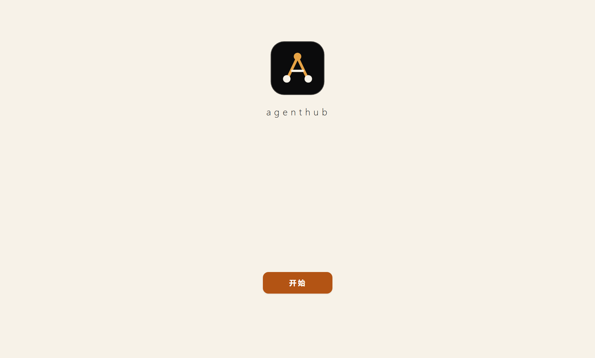

# AgentHub

多 Agent 工作台与工作流协作桌面应用（Windows 优先）。



## 下载即用（免安装）

从 [Releases](https://github.com/mihayoufamily/agenthub/releases/latest) 下载 zip → 解压到任意目录 → 双击 `AgentHub.exe`。

- 本地数据保存在 `%APPDATA%\agenthub\`，删除该目录即可彻底清除
- 首次使用建议：添加 Agent → 演示 Agent，无需任何配置即可体验完整流程
- 应用内会自动检查新版本（GitHub Releases，3 天一次），发现新版顶部提示，前往 Releases 手动下载

## 这是什么

AgentHub 提供两种工作方式：

- **工作台模式**：在同一个应用里自由切换多个 Agent，每个 Agent 保留自己的会话、输入草稿与运行状态；支持拖拽排序、Shift+滚轮切换、Agent 间交接、每 Agent 多会话（新建/切换/重命名/删除，草稿随会话保留）。
- **工作流模式**：规划 Agent → 执行 Agent → 审核 Agent 依次协作，未通过审核则返工（默认最多 3 轮，可配置），支持自动审核与人工确认两种方式，完成后输出交付卡片。

视觉与交互对标 Codex / WorkBuddy / DSH / 豆包 / Tabbit 的产品形态（仅界面与交互，不涉及模型能力，不使用任何第三方品牌素材）。

## 快速开始（源码运行）

```bash
npm install          # 国内网络可用：npm install --registry=https://registry.npmmirror.com
npm run dev          # 构建并启动桌面应用
```

要求：Node.js ≥ 18，Windows 10/11（已在 Windows 上实际验证）。

## 打包

```bash
npm run pack:portable   # 生成免安装便携目录 release/AgentHub-win-x64/（本机已验证）
npm run dist            # 生成 NSIS 安装包（需要环境能运行 electron-builder 的 app-builder，见下述已知限制）
```

## 功能状态（如实声明）

### 已实现并验证 ✅

- 开屏动画时间线（黑底 → Logo → 奶白过渡 → 开始按钮），支持 Esc 跳过与"减少动态效果"
- 每次启动播放完整欢迎流程，点击"开始"进入品牌首页（"今天要构建什么"），工作模式自选；运行中任务在后台恢复，进入工作流可见
- 品牌首页：多行输入（自适应增高）、Enter/Shift+Enter 发送（可配置）、中文输入法安全（组合中不误发）、文本附件（白名单类型 ≤64KB，内容随真实调用发送；演示 Agent 仅展示引用）、草稿持久化
- 工作台：侧栏 Agent 列表（状态点/未读提示/演示徽章）、管理顺序窗口（拖拽 + 上下移 + 持久化）、移除时区分"移除连接"与"删除历史"、Shift+滚轮节流切换（边界停止）、交给其他 Agent（带预览）、单 Agent 聊天记录导出（Markdown）
- 多会话：每 Agent 独立会话列表（新建/切换/重命名/删除）、草稿随会话保留、首条消息自动命名、活跃会话持久化（重启恢复）、旧单会话数据自动迁移
- 工作流：三角色配置条（悬停 200ms 预览浮层 + 点击固定面板）、任务状态机、规划/执行/审核卡片（流式输出、可折叠过程区、完成后自动折叠且不打断阅读）、人工确认门（通过并交付 / 填意见返工 / 停止）、返工上限（保留成果等待决定）、超时停止、补充要求下一轮生效
- 工作流真实引擎：三角色为自定义模型 Agent 时经 OpenAI 兼容接口**真实流式调用**（角色提示词注入、结构化验收清单输出、解析失败降级纯文本并转人工确认）；审核无法逐项判定时不放行也不盲目返工；演示 Agent 参与的角色逐卡标注"演示"，绝不把脚本内容包装成真实执行
- 工作流产物目录（可指定，默认 文档/AgentHub-artifacts）：执行/审核角色运行时文件工具沙箱根**临时切到该目录**（只换目录，不提升访问级别）；CLI 角色的工作目录同样切到该目录。未授权任何文件能力的执行角色，其文本结论由 AgentHub 写成本目录下一篇 `.md` 产物（文件名取任务目标，512KB 上限，内容超长按字符截断），产物与执行方自己写盘的文件用 `by` 字段区分来源，界面分别标"执行方写盘 / AgentHub 保存"。入口与工作站同形：配置条与任务顶栏都有「产物：<目录名>」chip，点开可自选文件夹、打开当前文件夹、恢复默认；导出的任务记录默认也落在这个目录
- 工作流预设：把当前三角色（含各角色的模型覆盖）存成一个命名预设，一键套用。**预设只动"用谁来干"**——目标文字、产物目录、审核方式与轮次不受影响；同名保存即更新。旧的"保存任务（目标 + 配置的快捷卡片）"已删除
- 工作流任务列表（不限个数）：左侧栏「工作流」区列出所有任务（进行中/待确认排前，其余为可回看的历史），点开设定目标与产物即切换过去继续看；新建按钮开新任务，逐条可删（连同落盘记录）。**数据源就是任务记录本身**，所以进度天然随退出保留、不需要第二套存储；重启后正在跑的部分标为「状态未知」并等用户手动继续，绝不自动重放
- 单执行循环约束：同一时刻只有一个工作流在跑，正在执行时切换/新建/删除会被拦住并说明原因（不会出现两个任务抢同一个引擎、半途互相覆盖状态的假并行）
- 两种模式共用同一根左侧栏（Agent 列表 / 工作流列表 / 切换模式 / 设置固定同一处）：工作流页面不再有自己的右上角入口，切模式时界面骨架不动
- 后台运行可见性：任务在跑时离开工作流界面（回工作站聊天）不会中断；侧栏常驻一行进度（当前轮次与状态），到确认门或结束时发系统通知（窗口正聚焦则不打扰，避免重复）
- Agent 常驻提示词：每个 Agent 可写一段"我对这个执行者的长期要求"，工作站每次对话与工作流每个角色调用时自动拼上；工作流里排在角色协议**之后**，不会覆盖输出格式与能力边界
- Skill 体系：启用/禁用开关（禁用后不出现在引用列表也不注入）、**兼容 Agent Skills 开放标准**（导入含 `SKILL.md` 的目录，读 frontmatter 的 name/description，登记 `references/`、`scripts/` 等附带文件路径）、渐进式加载（引用的给正文，未引用的只给一行清单）。**不执行 skill 里的脚本**，要跑仍走命令授权
- 图片附件：png/jpg/jpeg/webp/gif（单张 ≤4MB），模型侧走 OpenAI 兼容的多模态 `image_url` + data URL，输入框显示缩略图；CLI 侧没有统一多模态入参，只把本机路径写进提示词并注明"由该 CLI 自行读取"。已知不支持视觉的模型直接拦下，未登记的提示后放行（不替服务端下结论）
- 调用账本与用量统计：每次真实调用落一条**只含元数据**的账本（耗时、事件数、token、错误信息；不记正文与凭据）。设置 → 用量统计按 harness × 模型聚合调用数/失败数/token/费用/均耗时，未上报 usage 的调用如实标注次数而不估算；对话栏底部一个图标按钮可直接看本 Agent 的统计与最近调用，支持导出 JSONL 与清空
- 快捷键自定义：切模式 / 打开设置 / 停止工作流 / 新建工作流四项可在设置里改键（按下即录制、冲突拒绝、可回默认）；**必须带修饰键**，不给裸键设全局键以免吃掉正常输入
- 角色级模型覆盖真实生效且持久：在工作流的角色浮层里换模型会写入配置，重启与"开始任务"都不再被抹回 Agent 自带模型（此前 `resolveRoles()` 重建角色对象时丢掉 `modelOverride`，表现为"工作流里切了模型又变回原模型，必须先去工作站切"）
- 交付卡片：完成内容、验收对照、产物列表（每个产物可点开本机文件）、产物目录（可一键打开文件夹）、导出任务记录（真实写盘）、继续修改（沿用上一任务执行/审核上下文）、新建任务
- 模式切换：运行中任务弹红色警告（图标 + 文字 + 默认焦点在安全项）；`Ctrl + M`（默认，可改键）在工作站 ↔ 工作流之间互切（设置弹窗打开时、非这两个界面时不响应；运行中同样先弹确认）
- 关闭应用要过确认（Electron 37.10.3）：**不再使用 Electron 默认应用菜单**——它的 Window ▸ Close（Ctrl+W）会直接关掉唯一窗口 → `window-all-closed` → 应用静默退出，`autoHideMenuBar` 只藏栏不注销加速键；同一条路径上的 **Ctrl+R 强制刷新**更阴，会把正在跑的工作流当场打断（渲染进程重载）。现在：没在跑 → 关闭即退出；正在跑 → 弹系统确认框，默认高亮「后台继续运行（收到托盘）」，另两选「仍然退出应用」「取消」；Alt+F4 与任务栏关闭走同一条判断。托盘常驻"显示主窗口 / 退出 AgentHub"，缩到托盘后再次双击应用图标会把窗口叫回来（不是"看起来没反应"）；通知点击也会唤回窗口
- 项目约定自动读取：进入工作目录自动读 `AGENTS.md` / `CLAUDE.md` 原文注入（工作站按 CLI 的 workDir 或模型 Agent 的沙箱根，工作流三个角色按产物目录），不用再手抄进 Agent 常驻提示词。注入顺序固定为**角色协议 → 项目约定 → 历史记忆 → 角色技能 → 常驻要求**，协议（输出格式与能力边界）不会被仓库里的文字覆盖；文件名与截断都在段落里如实标出
- 命令白名单 + 审批历史：`allowCommands` 不再是一刀切。默认逐条确认，三层判定：① 危险形态（`rm -rf`、`del /s`、`format`、`curl | sh`、`git push --force`、`git reset --hard` 等）**白名单覆盖不了**，永远要确认；② 命令按 `&& || ; |` 拆段逐段核对，`npm test && del x` 不能因为 `npm test` 在白名单里就整条放行；③ 规则默认整段相等才放行，以 `*` 结尾才是前缀放行。裁决与历史落 `userData/approvals.json`（白名单不在 agent config 里，渲染层写不动），超时/取消/界面没接住一律按拒绝；弹窗默认焦点在「拒绝」。要无人值守可在 Agent 工具面板显式改回「授权即放行」
- 改动检查点与回滚：工具层每次改文件前 copy-on-write 备份原件到 `userData/checkpoints/<任务id>/`，覆盖已有文件时算行级 diff。工作流整个任务共用 `run.id`（返工/续跑都回到任务开始前），工作站对话按 `reqId` 各一个。交付卡片与对话里能展开"本次改动 N 个文件 · 逐个看 diff · 回滚这些改动"
- 交付可验收：① 开工前拍目录基线，交付时列出"相比开始前新增/消失了哪些文件"（包含命令与 CLI 造成的改动，回滚清单管不到但看得见）；② 验收项可指向产物文件（规划/审核输出 `files`，界面拿真实目录核对，指到不存在的文件当场标红）；③ 目录里 ≥2 个文件时自动生成「产物索引.md」
- 工作流编排：`中断续跑`（重启后按已有卡片推断该从谁接着跑，绝不重放已产出过结论的角色；审核已完成的那种重新摆到确认门前让人决定）、`单角色重跑`（每张角色卡片一个"重跑"，只跑那一个角色、不动确认门、新增一张卡片而不改写历史）、`角色级 Skill 绑定`（绑到哪个角色就只进那个角色的提示词，停用的技能即便绑了也不注入）
- 工具 Hook：模型 Agent 每次工具调用前后执行你自己配的命令（`pre` 退出码非 0 = 否决并把原因回传模型；`post` 只观察与后处理，失败不撤销已落盘的改动但如实报告）。参数只走环境变量（`AHUB_HOOK_TOOL/_ARGS/_RESULT/_FILE/_DIR`）不做字符串拼接，工作目录固定为沙箱根，超时默认 15 秒
- 工具 Hook 能认出"这条命令我改过没有"：设置页每条规则旁边给出脱敏回显 + 12 位指纹，指纹是对**归一化后的命令原文**算的显示用散列（折叠多余空白、转小写之后逐字符算；所以大小写与空白的不同写法同指纹，改任意一个其它字符——包括被遮成 `***` 的凭据值——指纹就变）。它只给人肉眼核对用，**永不参与放行判定**，也不是加密原语；命令长度上限 4096 字符，超长**拒绝保存并把当前长度告诉你**，不在背后替你截断（截断等于悄悄改掉要执行的命令）
- **保存配置不再销毁你没填错的那几条**：`hooks:set` 与 `mcp:set` 原先在落盘前按校验规则过滤**整表**，一条不合格的记录（例如手搓进 `config.json` 的 >4096 字符 Hook）会在你改动任意 Hook/MCP 设置时**静默消失**。现在校验闸门抽成纯函数（`src/shared/hooks.partitionHookRules` / `src/shared/mcp-list.partitionMcpServers`），**被拒条目原样留在配置里**，并把拒绝原因逐条回传设置页点名显示（拨一个无关开关也要能看见那条提示）——与"重填不得销毁旧记录"的既有先例同口径。真机断言钉在 `approval-shot`；**条数上限（Hook 40 / MCP 20 / 单价不设）现在只挡界面「新增」那一关**，落盘不再按条数截断（手改进来的更多条目原样保住，界面到上限把添加按钮禁用并说明）
- MCP 客户端（tools-only）：只接 server 的 **tools**（不接 prompts/resources，不让外部 server 往上下文塞系统提示），第一版只支持 **stdio**。信任模型：全局 server 列表 + 各 Agent 勾选启用，首次连接弹窗把**实际执行的 `bin` + `args` 整行**和工具清单一起摊开（旧格式记录则显示原命令并明写"已停用"），「始终信任」后整组放行（可随时撤销）；信任标记在主进程 `approvals.json`，删掉 server 时信任一起清掉。一条模型请求一套连接，流结束/报错/取消都关掉 server 进程
- MCP 启动方式改为 argv 直传：配置存 `launch.bin` + `launch.args`，spawn 时数组原样交出去、**这一条路完全不经 shell 解析**（不再把整条命令串交给 cmd，配置里写什么都成不了语法）。`.cmd`/`.bat` 与 `npx`/`npm`/`pnpm`/`yarn` 这几个 PATH 上没有同名 `.exe` 的启动器仍必须经 `cmd.exe` 包一层，但参数走**拒绝式**构造器（`cmdUnsafeReason`：含 `"` `%` `&` `|` `^` `<` `>` 的 token 直接拒收并点名该参数，实测引号在 `cmd /d /c` 路径上挡不住它们），设置页与信任弹窗逐条标注"经 cmd 启动"，不许声称纯 argv 直传
- `launch.args` 的判定现在**容器与元素同口径**：`planSpawn` 此前只在"数组里某个元素是脏值"时抛错，`args` 本体不是数组（手改成字符串/对象）却被当成"没声明参数"静默放过，于是 `mcp:probe` 探测的是一条**与你配置不同的命令**、报出来的 `spawn ENOENT` 指向另一个可执行文件。现在容器形状不对也按同一措辞骨架显式拒收并点名该字段，只有键真不存在（`undefined`）才算"没参数"。渲染层读取路径仍按 `sanitizeMcpList` 补形成 `[]`（那是"别让设置页炸"的另一件事，两者不混）
- 旧版单命令 MCP 配置一律标失效并停用（**这是 0.3.x 用户要重填的破坏性变更**）：迁移到 `schemaVersion 2` 时把只有 `command` 的记录打上 `legacyInvalid` + `enabled: false`，原文保留——不自动拆分（拆错的命令行比"连不上"更难定位）、不删除；设置页逐条给「重填」，原命令填回草稿，保存新记录之前旧行仍留在列表里可恢复，保存后旧条目连同它的信任一起失效
- 渲染层读 MCP 列表只过一道形状闸门（`sanitizeMcpList`：非对象/没有 `id` 的元素一律不收，`launch.args` 缺失或不是数组补成 `[]`，只有旧 `command` 的记录就地补上失效标记）：手改坏的 `config.json` 元素不会再让设置页或对话请求当场抛 `TypeError`，主进程与界面共用这同一道闸
- 预算硬闸：工作流可设费用上限（元），每个阶段开始前核对**本次任务**已折算的花费（账本按 `runId` 归本，同时发生的工作站对话不算进来），到线就停在阶段之前而不是跑完这一轮，状态 `budget_limit` 给终态出口卡。金额口径依赖单价数据，没单价的调用不折算，所以是**下界**不是总账
- 单价时效与自填覆盖：内置表只标"手抄快照、未逐条复核"（不给它编日期）；可在设置填自定义单价（正则 + 输入/输出价 + 填写日期，随配置导出导入），每行金额下面标出是按"自填价·某日"还是"内置表快照"算的，非法正则的条目被跳过而不是打挂计价
- 长期记忆能检索回来了：以前只写不读。现在按当前目标/本轮提问做关键词打分，只注入相关的少数几条（默认 8 条、4KB 封顶，0 分不给），并写明"这是历史记忆，与本次目标冲突时以本次为准"；交付时自动沉淀成果摘要与未通过项，条数上限 300
- 代码库概览（repo map）：进目录扫源码按行首声明正则抽顶层符号（TS/JS/Python/Go/Rust/C++），拼成"路径 — 符号"注入，大项目里不用靠 grep 摸黑找入口。没有 AST/LSP，所以概览自己写着"会漏会错，当地图用别当事实用"，单文件 16KB/整块 32KB 与总 6000 字符的上限都会说明省略了多少
- 长对话按 token 预算折叠：以前只按条数开窗，长会话要么撑爆窗口要么悄悄丢上下文。现在按该连接真实窗口算预算（7 成，余量留给系统块与模型输出），装不下就从最旧一端折成一条摘要，再挤也保留最近 4 轮；摘要写明是规则式压缩（取每条开头）、原文本轮未发送
- 设置十一分区：外观 / Agent 与模型 / Skill / 工作流 / 用量统计 / 命令审批 / 工具 Hook / MCP / 快捷键 / 数据 / 关于
- 真机层不再写脏开发机的配置：`ui-shot` 会经 `__ahub_debug.startMockToolTask` 走 `patchConfig` 改**用户全局角色绑定**（`workflowDefaults`），而它的收尾原先只按名字删 Mock Agent、不回滚绑定——跑完一轮，三个角色就水合成 `本地 · 自动`。现在动任何配置**之前**先按**文件字节**快照整份 `config.json`，收尾等实例退净后按字节回写，并有一条断言证明还原真的跑了（回写后重读，字节必须相等且 `workflowDefaults` 三个 id 逐一对上）。同一道闸门也加在 `approval-shot`：上一轮实例没退净时**拒绝回写快照**并记一条 FAIL（原先只打一行 WARN 就继续往活实例的文件里写），且 listen 挪进 `try`、异常路径也打汇总行、**有 FAIL 就退非 0**（它曾是九个真机套件里唯一"红了也退 0"的那个）。快照落点按**文件身份**（`dev`+`ino`）核对而不是按字面路径字符串比——Windows 上 `app.getPath('userData')` 报 `…\Roaming\AgentHub`、盘上目录名是 `agenthub`，NTFS 大小写不敏感，那是同一份文件
- `wf-config` 套件不再按大小写敏感匹配用户自填的 Agent 名：本机那个 Agent 显示名叫 `DeepSeek`，脚本用 `a.name.includes('deepseek')` 找它，于是**前置条件恒失败、后面 7 条 check 一条没跑完过**（不是产品缺陷、也不是环境问题）。现在匹配双边 `toLowerCase()`、chip 正则统一加 `i`，套件跑通；同时它的汇总行补齐，`run-all` 不再显示 `-/-`
- 回归验证一条命令收口：`npm run verify`（纯逻辑层，不起应用不花额度）、`npm run verify:gui`（加 CDP 真机层）、`npm run verify:all`（再加真实 CLI 层）。跑批前先过构建门禁（类型检查失败时后面的绿都不算），套件之间等上一个应用退净（单实例锁会把残留进程报成 "devtools not ready" 假失败）
- 每个套件的**断言数下限**由 `verify/run-all.mjs` 的 `SUITES` 表钉死（随每轮全量实测取值）：`fixes` 494 / `deliver` 52 / `ui` 79 / `approval` 94 / `cli-e2e` 10 / `cli-shot` 4 / `wf-config` 7 / `model-picker` 3 / `model-list` 3 / **`cli-thinking` 8**。实测 PASS 低于下限就跑红并点名"断言数从 N 掉到 M"，"谁删了十条断言套件照样报 OK"这件事从此可见；退出码 0 但没打印 `结果：N PASS / M FAIL` 的套件同样判红（历史上它会被读成通过）。**`cli-thinking` 原来是恒红的，红点不在被测代码**：它调适配层时不传模型，于是 codex 回落到 `~/.codex/config.toml` 的全局默认 `gpt-5.5`，而这个模型被本地代理**广告在 `/models` 里、真调用时拒**——"取清单第一个"因此是坏规则。现在套件读**只读**的用户配置里该 CLI Agent 已绑的模型与思考强度（就是工作站跑得通的那套参数），并留 `--model` 覆盖，实测 **8 PASS / 0 FAIL**。**还剩两套没有下限**：`cli-workflow`（脚本从用户保存的工作流配置里读到已不存在的产物目录，产品这里是刻意守卫）与 `cross-vendor`（前置断言要求用户当前的三角色绑定顺序恰好是脚本预期）——两套都属套件耦合本机现状、改成自足（临时产物目录 / 自我绑定角色）才谈下限，把下限钉在红数字上等于把"红"当基线。另有 `cli-shot` 与 `model-list` 是 `gate: false` 的只报不拦套件：越过下限打 `WARN`、不影响退出码（既有语义）
- CI 现在真跑回归：`ci.yml` 依次执行 `npm run lint` → `npm run build` → `npm run verify` → `npm audit --omit=dev --audit-level=high`。CI 实际拦到的计数是逻辑层 **546 条**（`fixes-check` 494 + `deliver` 52，2026-10-24 实测；这些断言此前只在开发机上跑过，流水线只验构建）。YAML 注释里**不写具体条数**（会随套件增长漂移成第二个假真相源），计数口径由上一条的每套件 `min` 负责。**注意 CI 只跑到逻辑层**：`npm run verify:gui` 与 CLI 层不在流水线里（要 Electron 二进制与本机 CLI），所以界面真机与真 CLI 的绿是"每次发版前人工跑一轮"的结果，不是流水线保证的
- ESLint 平铺配置（`eslint.config.mjs`）：注入面 5 条规则设 error——`react/no-danger`、`react/no-danger-with-children`、`no-eval`、`no-new-func`、`no-implied-eval`（后者显式声明 `setTimeout` 等全局，否则 `setTimeout('字符串')` 会被静默放过）；`@typescript-eslint/recommended` 整体降为 warn，不拦构建只做卫生提示。**这 5 条 error 现在关不掉了**：`linterOptions.noInlineConfig: true` 上齐三处（顶层默认块 / `src/**` 块 / 发版路径块），一行 `// eslint-disable-next-line no-eval` 不再能静默取消这台机器；顶层那条单独成块是必须的——flat config 里只有带 `ignores` 的对象才是全局忽略，把 `linterOptions` 塞进去会让 `ignores` 退化成局部排除，`out/dist/release/node_modules` 就又被 parse 一遍。`impliedEvalGlobals` 也校准成规则**真会查**的那一组（`setTimeout` / `setInterval` / `execScript` + `window` / `global` / `globalThis`；原先声明的 7 个 `setImmediate`/`requestAnimationFrame` 之类名字一条都不报，已删）。发版路径 `verify/**/*.mjs` 与 `scripts/**/*.mjs` 从"零规则过一遍"改成吃同一份 5 条 error 规则（纳入后 warn 总数没变，仍是那 24 条：这些文件只吃 5 条 error 规则、不吃 ts recommended 的 warn 集）。这台机器本身也有牙：`fixes-check` 的 `[Z4]` 段**真跑本地 eslint CLI**（喂已知 sink 进 `--stdin --stdin-filename`，证明 disable 注释关不掉 `no-eval`、裸 `execScript('…')` 会被咬住、规则够不着的名字一条不报），eslint 装不上时一律 FAIL 不 skip。当前基线 **0 error / 24 warn**（2026-10-24 实测）。**规则覆盖不到的写法仍在下方 ❌ 如实记着**
- `release.yml` 打的便携 zip 改为**平铺**（用系统自带 bsdtar：`tar.exe -a -c -f ... -C release/AgentHub-win-x64 .`，解压即见 `AgentHub.exe`；旧的 `Compress-Archive -Path 目录` 会把 118 个条目全套进一层目录，与历史包和使用说明不一致），流水线内自检包内必须有根级 `AgentHub.exe` 才继续发布
- 项目长期记忆（与任务记录分离，可查看/修改/删除）
- 数据持久化：配置带版本号 + 迁移（当前 `schemaVersion 2`：MCP argv 化打标 + `sandboxFallback` 默认值；规则抽在纯模块 `src/shared/config-migration.ts`，`store.ts` 只读写盘，所以迁移链能在逻辑层逐条断言）、会话与任务记录独立 JSON、API Key 用系统安全凭据存储（safeStorage 加密）、配置导出不含任何秘密
- **修掉 v0.3.0 的导入数据丢失**（用户可见）：`importConfig` 原先用"重建字面量"的方式做迁移，只留 `schemaVersion/prefs/agents/workflowDefaults` 四项——导入任何配置都会**静默丢掉** `mcpServers` / 预设 / Hook / 单价覆盖 / Skill，界面上只表现为"导入成功"。现在改为保留未知键 + 跑完整迁移链，并加了一条真机导入往返断言（导入前配好的 server/预设/Hook 导入后仍在）
- Agent 连接状态里的 `running` / `awaiting` 是**单次会话的瞬时态**：既不写进用户配置，也不在重启后复活（此前一次会话中途退出会把状态永久留在 running，而工作流校验只认 available，导致该 Agent 再也无法参与任务）
- Agent 扫描：仅查 PATH 上的常见 CLI，不读任何软件配置/密钥；发现 ≠ 接入（如实标注）
- 模型 API（OpenAI 兼容）：真实连接测试 + 流式对话 + 取消；无 Key 时如实报错
- 本地 CLI Agent 执行适配器（统一 `CliTarget`：真 exe + 前置参数 + 环境变量，非 PATH 安装按"已知位置 + 盘符浅扫描"定位；spawn 不经 shell、stdin 关闭）：
  - **arkcli 本机实测**：`+chat` 流式 NDJSON、真实推理、取消、用量统计
  - **Codex CLI 本机实测**：`exec --json` JSONL；支持应用安装形态 `%LOCALAPPDATA%\OpenAI\Codex\bin\<hash>\codex.exe`；上游错误（如 429）如实透出
  - **CodeBuddy Code 本机实测**：官方 npm 包 `@tencent-ai/codebuddy-code` 优先，WorkBuddy 内置 lite 版兜底；`-p --output-format stream-json`；未登录时原样返回 `Authentication required`
  - **DeepSeek Harness headless 本机实测**：`dsh headless`（纯文本、非流式）；缺模型凭据时原样返回 `MISSING_CREDENTIAL`
  - **claude 未实测**：按官方 CLI 规范实现，未安装时如实报错
  - 共同点：凭据全部由 CLI 自身管理，本应用不读取任何密钥；支持 Agent 级工作目录边界
- CLI 工具事件透传：CodeBuddy/Claude 的 tool_use/tool_result、codex 的命令执行与文件变更实时进入执行卡片（单聊与工作流，产物可登记）；按角色区分的调用超时（规划 3 分钟/审核 5 分钟/执行 10 分钟，超时保留已产出）与 90 秒无输出心跳提示
- 模型 Agent 思考模型支持（DeepSeek/方舟等）：reasoning_content 流式采集 + 工作台对话内折叠展示 + 工作流角色卡片过程区"思考"条目（两条路径本机已用 mock 服务实测）。多轮回传**默认关闭**：工具循环中回传 reasoning_content 在 OpenAI o 系列等严格接口上会直接 400，故默认剥离，确需回传设 `AGENTHUB_PASS_REASONING=1`（该开关未实测）
- 长思考默认只显重点：思考按段落打分（结论/因果/风险/验证类词加权，"让我看看"式过场句减分）取前 5 段展示，其余收进"展开其余 N 段"，**只改默认可见范围、不改写模型原文**；≤2 段的短思考不裁剪，流式过程中也不裁剪（避免内容跳变）。多轮工具循环 / 多个思考块之间会补空行分段，否则黏成一段后永远切不开
- CLI 角色的思考过程同样进卡片过程区：codex 的 `item.completed/reasoning`（含 summary 数组）、CodeBuddy/Claude 的 `content[].thinking` 块去重后作为"思考"条目；codex/claude 的思考强度按 Agent 配置下发（`model_reasoning_effort` / `MAX_THINKING_TOKENS`），此前工作流漏传该参数导致 codex 在工作流里不出思考。**CodeBuddy 与 codex 都已用真实工作流任务端到端实测**：2026-10-24 一轮 `planner=CodeBuddy / executor=codex / reviewer=DeepSeek` 的真跑记录里，两张 codex 执行卡各带 7–8 条思考条目与 9–10 条工具条目，产物 `hello.c` / `env_check.txt` 以 `by:"tool"`（执行方自己写盘）登记进任务
- **codex 执行角色此前写不了任何文件，已修**：`codex exec` 的**默认沙箱是 read-only**，而适配器从来没传 `--sandbox`，于是模型连我们给它设的产物目录都写不进去（界面表现为"文件系统只读"）。现在显式下发 `--sandbox workspace-write`（写范围 = 该次调用的 cwd，不是全盘；网络仍按 codex 默认关闭）。参数顺序另收成一条**不变量**：codex 的签名是 `exec [OPTIONS] [PROMPT]`，prompt 恒为最后一个。**这里要说准口径**：单变量复测证明旧顺序（`-m`/`-c` 追在位置参数之后）在本机**同样生效**，所以顺序不是"套件思考 0 段"的根因（根因是强度被写成 `low`）；这条不变量是不给参数解析器留赌注，不是在修一条观察到的坏行为。配套**跑真代码**的断言（`cliArgsFor` 纯函数缝：删参数、或把 flag 排到 prompt 之后就红，写在注释里满足不了）。配套**跑真代码**的断言（`cliArgsFor` 纯函数缝：删参数或把 flag 排到 prompt 之后就红，写在注释里满足不了）
- `file_change` 事件的形状变了（`changes: [{path, kind}]`，旧实现读顶层 `path`），于是**执行方自己写盘的文件登记不上**——卡面上"声称写了文件、产物列表是空的"。现在新旧两种形状都认，空 `path` 丢掉。另：主进程 `console.log/error` 现在整体镜像进 `logs/main.log`（2MB 滚动、单行截 2000 字符），因为打包版没有控制台，`[cli] exe/cwd/args` 那行诊断只能落在这里看
- 模型 Agent 工具层（Agent 级授权）：沙箱内读/写/列出/删除（回收站）/移动 + `search_files` 文本搜索 / `glob_files` 通配查找 / `replace_in_file` 精准替换（通配匹配为非正则实现，模型可控模式不会打爆主进程；本机已用临时沙箱 + mock 服务实测）
- 联网工具（`allowWeb` 单独开关，默认关）：`web_fetch` 抓网页转纯文本（流式读取、200KB 上限；环回/内网/链路本地地址与跳转后落入内网一律拒绝）、`web_search` 走 DuckDuckGo HTML（**非官方接口**，结构变化即失效）。SSRF 拦截本机已断言验证；真实外网抓取未实测
- 权限两档：沙箱（默认；路径规范化 + realpath 复核）/ 完全访问（全盘文件 + 命令不限目录；顶栏红色徽章常显，保存需勾选风险确认）——界面已实机核验
- 窗口导航兜底（**防退化，本机原来没有活漏洞**：渲染层 0 处 `target=_blank`/`window.open`/`innerHTML`）：新窗口请求、同窗口导航、服务端重定向三个入口共用一个纯函数裁决 `navDecision`——本地页面放行（开发模式比 dev origin，生产 `file://` 要求空主机 + 解码后手工折叠 `..` + 锚定真实 renderer 根）、http(s) 外链转系统浏览器、其余协议（`javascript:`/`data:`/自定义 scheme）既不加载也不丢给系统。原先这三个入口一个裁决都没有（渲染层没有 `_blank`/`window.open`，所以今天不是补洞）；规则集中写在一个纯函数里、逻辑层逐条断言，将来谁再加新窗口路径也躲不开这道判定。**锚点现在也是机器保证的**：第三个实参（真实安装根）非字符串时按"无可用锚点"处理并 **fail-closed 返回 block**，不再从 Electron 的导航回调里抛 `TypeError`；同时 `fixes-check` 扫 `src/**` 每一处 `navDecision(` 调用点、断言实参个数恒为 3（并钉一条"扫描器自己有牙"防止空转永真），所以"调用点必须传锚"从来到验证层就不靠人记得
- 沙箱降级策略三态可改（设置 → 关于 → 降级策略）：`自动降级 / 每次问我 / 不自动降级`，脏值一律归 `自动`；`不自动降级` 覆盖**整条阶梯**——连第 1 次崩溃的 `--disable-gpu` 软件渲染兜底也不自动重启，直接报启动失败并让你自己跑 `start-compat-mode.cmd`。真降级后顶栏常驻「兼容模式 · 渲染沙箱已关闭」徽章，措辞由共享纯函数按**实际关掉了什么**算（沙箱/硬件加速/两者），不按配置里写了什么；没降级时徽章返回 null 连占位都不留，单挂在 `Shell` 一处覆盖工作站/工作流两种模式
- 徽章不再被更新横幅盖住、也不再接走顶栏点击：有待更新横幅时（同为顶部居中、`z-index` 900 对徽章 30）徽章整块**下移**让位、横幅清除后回到原位，判定按实际状态而不是"有横幅就藏徽章"；徽章本体设 `pointer-events: none`，中间区域的点击回到它真正的目标（顶栏 chip）身上。断言量的是几何事实——徽章与横幅的矩形不相交、`elementFromPoint(徽章中心)` 命中的不是横幅、某个已知顶栏 chip 中心命中的是它自己——不是"元素在 DOM 里存在"
- 降级阶梯的四条分支（`none` / `fail` / `ask` / `relaunch`，含 GPU 档闸门）现在逐条绑住"条件→动作"，弹窗文案抽成 `src/shared/compat.ts` 的导出常量（原先一份被断言的常量 + 两处手抄字面量，改文案不会红）。顺带关掉一条静默穿透：`off` + 用户自己设了 `AGENTHUB_NO_GPU=1` + 第 1 次崩溃时，旧写法让代码从 GPU 档下方穿过、又没到沙箱阈值（2），**既不重启也不报错**，只是安静等第二次崩溃——而 `off` 的文案承诺的是"窗口出现前崩溃就直接报启动失败"。现在 `off` 两种情形都走 `fail`，"已软件渲染"只影响 `auto`/`ask`
- 用量与费用：消息下显示本轮 token（入/出）与费用、会话累计；**模型选择、上下文用量、本会话累计消耗、余额集中在对话栏底部条**（离输入框最近；CLI/演示 Agent 的模型 chip 退化为只读并说明"模型由接入方自身决定"），顶栏只留会话/工具/目录等与当前对话直接相关的入口。入/出与费用经 mock 服务实测（含工具循环多轮累加与单价折算）；**依赖服务端在流式响应中返回 usage**，不返回时只显示上下文估算、不显示本轮费用
- 余额：设置/顶栏显示账户余额（DeepSeek 走官方余额接口）——**未实测**（需真实 Key）
- Skill 体系：可复用提示包，设置 → Skill 可创建/导入/编辑/删除，输入框引用注入本次对话——界面已实机核验，引用注入链路未实测
- 工作流终态出口：停止/失败/超时后提供「新建任务 / 以此为目标开新任务 / 导出任务记录」，失败原因写入 `run.notes`——**未实测**（本轮未跑真实工作流）
- 错误信息中文化：限流/未登录/缺凭据/权限拒绝/认证失败等常见错误映射为人话提示 + 原文折叠
- **同一条命令在界面上只有一个显示口径**：对话里的工具卡原先印**原始** hook 命令，而隔壁设置页印脱敏形态——同一个凭据两个地方显示不同，其中一个还把明文留在聊天历史里。现在工具卡也走 `@shared/approvals` 的 `redactCommandForDisplay` 入口（与设置页同一函数，不是各处再抄一遍规则）。MCP 信任弹窗的参数显示从裸空格 join 改成 `JSON.stringify([file, ...args])`（与设置页「实际执行」预览同形，空格路径不会被看成两个参数），真机断言也跟着**收紧**：整串必须能 `JSON.parse` 成数组且第 0 项逐字符等于可执行文件路径。加载失败错误页的 `${desc}` 此前是往特权 `data:` 页面做**未转义插值**（本分支唯一一处），现在过 `escapeHtmlText`，实体集与 `tools.ts` 的 `htmlToText` 解码集对称，两个 `did-fail-load` 监听器也合并成一个
- 工作流首页在**应用自身最小宽度**下不再横向溢出：`.wf-composer-wrap` 的宽度从 `min(760px, 92vw)` 改成 `min(760px, 92%)`——这个元素坐在「侧栏 + 内容列」的 flex 里，`vw` 量的是视口而不是它的包含块，窗口 956 时内容列只有 696，760 宽的 composer 直接溢出。真机审计也不再拿"用户上次把窗口拖多大"当被测宽度：两条溢出断言各自钉在显式视口上（960×720 守应用最小宽度、1280×800 守默认/常用宽度不回归），且要求被测对象在场（首页没渲染时 `composer` 取到 null，那种"绿"是 0 个测量对象而不是没有问题）
- 工作流三角色同源警示：审核方与执行方同源时在确认门与交付卡片黄字提示（不阻止）
- 应用内更新检查（GitHub Releases 比对版本，手动下载模式，不自动安装）与开机自启开关（设置 → 关于）
- 应用图标与打包资源：Logo 同源 ico（256/48/32/16），NSIS 与便携版均已接入
- 本地 E2E（`npm run test:e2e`，CDP 驱动便携版）：启动序列/演示对话/多会话/设置入口断言（见 tests/e2e/README.md）
- 演示模式：无任何真实 Agent/Key 可跑通全流程（含一次返工与人工确认），全程清晰标注"演示"

### 演示模式边界 ⚠️

演示 Agent 的回复、工具事件、产物均为脚本化内容，**不是真实模型输出**，产物不写盘，界面全程带"演示"徽章，绝不包装成真实执行。

### 未实现 / 已知限制 ❌

- **工作流不能并行执行**：引擎只有一个执行循环，任务列表是"多个可回看的工作流 + 同时只跑一个"，正在跑的时候切换/新建/删除都会被拦住；真并行要把引擎改成多实例（请求路由、取消、Token 上限、产物目录按任务隔离）
- **任务列表保留进度，不保留附件**：切换任务或重启后，文本与图片附件都要重新添加（附件正文可能几十 KB×N，不进持久化）
- **图片输入依赖模型支持视觉**：只有 OpenAI 兼容的 `image_url` 一条通路；`visionOf()` 是内置对照表，新模型未登记时按"提示后放行"处理，不做能力探测。CLI 侧不传图，只传本机路径
- **用量统计的口径受服务端限制**：token 与费用只在服务端返回 `usage` 时才有值；CLI 侧多数不上报，表里会标"未上报"而不是估算一个数
- **调用账本只存最近 2000 条**：滚动淘汰，不是完整账单历史；要长期留档需定期导出
- **回滚只覆盖工具层的文件操作**：`write_file` / `replace_in_file` / `delete_file` / `move` 与 AgentHub 自己的文本落盘在检查点清单里、可一键回滚；`run_command` 与 CLI Agent 自己写的文件不在这条链上，回滚撤销不了它们（目录对照能看到变化，但改不回来）。完全访问模式下的目录外改动同样不纳入回滚，界面逐条标注
- **命令审批只覆盖模型 Agent 的工具层**：CLI Agent 的命令确认由它自己的 CLI 负责（CodeBuddy/Codex 各自的权限模式），AgentHub 不替它做决定也不重复问；因此 CLI 路径上没有"逐条确认"这层
- **预算硬闸是下界**：只统计算得出金额的调用（有公开单价或自填单价），CLI 侧多数不上报 usage 也没有公开单价，那条链上预算闸基本不会触发。要真正兜住成本请同时设 Token 上限
- **repo map 是正则猜的，不是 AST/LSP**：只认行首声明，会漏（缩进的导出、宏生成的符号）也会错；注入时明确标注"当地图用，别当事实用"。刻意不引 LSP——多一套语言服务进程与安装成本，收益不匹配
- **摘要压缩是规则式的**：折叠最旧轮次时取每条开头拼成摘要，不调用模型做语义总结（省一次额度，但会丢细节）。摘要文本里写着"不是模型读完写的总结"，历史窗口截断也不冒充完整上下文
- **MCP 只支持 stdio 且只有 tools**：远程 HTTP/SSE server、prompts/resources、采样/roots 能力都没做。连不上时如实报一条提示并让其余工具照常工作
- **MCP 的 `.cmd` 家族仍经 cmd 启动**：Windows 上 `npx`/`npm`/`pnpm`/`yarn` 的真身是 `.CMD`（PATH 上没有同名 `.exe`），Node 对 `.bat/.cmd` 在非 shell 启动下另有专门限制，硬走 argv 只会 `ENOENT`。因此**不能声称"纯 shell:false"**——只有 argv 直传的 `.exe`/带路径脚本才是；界面与信任弹窗会在该 server 上标"经 cmd 启动"
- **经 cmd 那条路对参数有拒收规则（限制，不是防护完成）**：token 含 `"` `%` `&` `|` `^` `<` `>` 时直接拒绝启动并点名该参数。依据是实测结论：cmd 的引号规则里没有"转义引号"这东西（`\"` 只是普通反斜杠 + 引号区在下一个 `"` 处关掉），`%` 在引号内照样展开，而 `cmd /d /c` 会剥掉首尾引号对——**加引号并不能让元字符变安全**，所以拒收与有没有空格无关。代价：`--filter="a b"`、`--out=x>y` 这类写法在这条分支上起不来（argv 直传那条不受影响）；同一行里出现第二对引号时 cmd 剥首尾引号会让该 server 起不来（旧实现同样起不来，不是能力回退，且失败是响的、不会退化成注入）
- **旧版 MCP 配置不自动迁移**：v0.3.x 填的单命令串在 v0.4.0 一律停用，需重填。刻意不猜拆分：拆错的命令行比"连不上"更难定位
- **Hook 不逐条问你**：配了 Hook 就等于让 AgentHub 在每次工具调用时代你执行那些命令，这是与命令审批不同的信任层，设置页红字标注
- **AgentHub 兜底落盘只保存执行结论正文**：执行角色没有文件能力时，成果由 AgentHub 写成一篇 `.md`（界面与文件开头都明写"由 AgentHub 落盘"）。这是文本交付，不是执行方自己写的代码文件，两者来源不混
- **claude CLI 适配器未实测**：适配层已按官方 CLI 规范实现（见 docs/AGENT_ADAPTERS.md），但本机未安装，无法端到端验证；arkcli / codex / codebuddy / dsh 四个适配器均已本机实测
- **CodeBuddy CLI 需先登录**：装官方 CLI（`npm i -g @tencent-ai/codebuddy-code`）后在终端执行 `codebuddy` → `/login`（或设 `CODEBUDDY_API_KEY`）。WorkBuddy 内置的 lite 版**没有交互模式**，无法在其中登录，但它与官方 CLI 共享 `~/.codebuddy` 凭据，登录后同样可用
- **DSH headless 需模型凭据**：`dsh headless` 走 DeepSeek Harness 的凭据服务，启动环境里需要有 `DEEPSEEK_API_KEY`（或在 DSH 的 web profile Models 页写入），否则返回 `MISSING_CREDENTIAL`；且它的输出是纯文本非流式，卡片内容在任务结束时一次性出现
- **electron-builder 打包在本机跑不通（拦的是 app-builder 这个进程，不是"不能执行"）**：本机安全软件拒掉它的**一切建目录/写文件**——实测三个位置全报 `Access is denied`：`%LOCALAPPDATA%\electron\Cache\*.zip.partN`、`mkdir %LOCALAPPDATA%\electron-builder`、`mkdir D:\tmp\eb-cache\winCodeSign`；同样这些目录用 shell 能建出来，所以是**按进程**拦的。最后统一表现为 `ERR_ELECTRON_BUILDER_CANNOT_EXECUTE`。`-c.electronDist=node_modules/electron/dist` 能省掉 134MB 的 electron 下载（本机缓存里本来就有），但救不了这个；换缓存目录（`ELECTRON_BUILDER_CACHE`）也一样。本机验证走 `pack:portable`（纯 JS、**不打 asar**）；NSIS 安装包与 asar 那层只能由 tag 后的 `release.yml` 在 GitHub runner 上验（那边不受本机策略限制），或者把 `node_modules\app-builder-bin\win\x64\app-builder.exe` 加进安全软件白名单
- **Chromium 沙箱兼容模式**：部分装有大数字类安全软件的机器上，Electron 的 GPU/渲染沙箱子进程会被拦截崩溃（0xC0000005）。降级策略三态可选（设置 → 关于），`AGENTHUB_NO_SANDBOX=1` 与同目录 `start-compat-mode.cmd` 仍可用（降低渲染进程隔离；本应用只加载本地页面，无远程内容）。正常机器无需开启。徽章按**事实**出，所以用户自己设 `AGENTHUB_NO_SANDBOX=1` 启动时也会显示（刻意如此：它写的是"这台机器现在关了什么"）；选 `不自动降级` 时渲染进程连续崩溃会**直接启动失败**（这是选择，不是故障），需要手动跑 `start-compat-mode.cmd`
- **兼容徽章在开屏与品牌首页两屏看不见**：这两屏挂在 `Shell` 之外，所以"常驻"目前只在两种工作模式内成立（v0.5.0 顶栏批次收口；本轮刻意没把徽章搬进那两屏）。原先同一条目里的另外两件事**已修**：有待更新横幅时徽章会被盖住、以及徽章接走中间区域的点击
- **`file://` 判定的无锚弱回退仍偏宽**：调用方没传真实安装根时，判定退回 `resources/app/dist/renderer/` 标记匹配，于是 `file:////evil.example\share\resources\app\dist\renderer\…`（内容来自攻击者指定的远程共享）仍会放行。生产三个调用点都带真实根，所以今天只是测试面；收掉它需要无根时一律 `return false` 并给约 10 条无锚断言显式传根。**本轮补的是"调用点必须传锚"这件事**（控制器裁决 Ruling S，选更便宜的守法而不是收紧回退）：`fixes-check` 扫 `src/**` 每一处 `navDecision(` 调用、断言实参个数恒为 3，并钉一条"扫描器自己有牙"（`index.ts` 必须命中 3 处）防止空扫永真；锚非字符串时改为 **fail-closed 返回 block**，不再从导航回调里抛 `TypeError`。所以现在的保证是"生产路径不可能不带锚"，而不是"无锚判定变严了"——后者仍留给 v0.5.0
- **渲染层调试钩子在发布版里仍可调用（本轮只记不修，v0.5.0 候选）**：`window.__ahub_debug` 在 `App.tsx` 的挂载 effect 里**无条件安装**，所以发布版也能调用 `startDemoTask` / `startCliTask` / `restoreWorkflowConfig` / `startMockToolTask` / `configRoundTrip` / `setUpdateBanner` 这些钩子——它们里有的能起真 CLI 任务、有的能改配置。**这不是一个可以靠"发布版藏掉它"解决的问题**：一个能把脚本注入渲染层的攻击者，拿到的是整个 `window.agenthub` IPC 桥，`__ahub_debug` 只是它外面的一层包装，闸掉包装不等于闸掉桥，收益是假的。真正的收口是把"验证态"判定推广到这些钩子与 IPC 桥本身——这套形状本仓已经有了（`config:importJson` 只在主进程 argv 带 `--ahub-verify` 且 env 显式为 `1` 时才注册，`app.isPackaged` 不能当闸门因为被测的部署构建本来就是 packaged 形态），只是 `__ahub_debug` 这一层没接进去。本轮未做，列进 v0.5.0 候选。本轮**刻意没有**在这条上动 `App.tsx` 的无条件安装：那会把依赖这些钩子的九个真机套件全部打成红，而换来的是薄壳
- **装在 UNC 路径上的应用无法在窗口内重载自己的页面**：`file://` 判定要求空主机（带主机名在 Windows 上就是 `\\server\share`，绝不能算本机页面），代价是网络盘安装形态下 F5/重载会被拦。启动走 `loadFile` 不触发 `will-navigate`，故开机不受影响
- **开发模式同源判定是字符串相等**：`VITE_DEV_SERVER_URL=http://localhost:5173` 时访问 `http://127.0.0.1:5173/` 会被判成外链转系统浏览器（`localhost` 与 `127.0.0.1` 视为不同源）；未打包形态下 `did-fail-load` 错误页的重试按钮会因重试 URL 被判 block 而失灵
- **ESLint 的保证面只有那 5 条 error 规则**：`innerHTML` 直接赋值 / `window.open` / `javascript:` URL / 动态 `href` 这些同样危险的写法**不在规则覆盖内**（今天 0 命中，靠人工维持，没有机器拦）；`react/no-danger` 也看不见经 prop 展开传进去的 HTML。计划与 spec 早期把这件事写成"注入面从此由机器保证"，那句已被最终评审判为夸大并订正。（同一条目原先还列着三件事——`noInlineConfig` 未设、`no-implied-eval` 全局名单两头不准、`verify/**` 与 `scripts/**` 零规则空转——三条都已在合并前修掉，见上方 ✅。）还有一条**规则之外的残留**：`scripts/build-renderer.mjs` 的 `shell:true` 带参数（DEP0190，Windows 上是既有噪声）不在那 5 条注入规则里，本轮没有为它加规则（加了就不再是 0 error），只做记录
- **需人工核验的三项**：`Ctrl+W`/Alt+F4 与托盘行为自 v0.3.0 起就标着"需人工核验"，本批没碰这段代码（风险没变大）但仍没人双击看过一次；真实图片输入后模型到底看到什么未复核；`npm run dev` 开发模式与 NSIS 安装包（`npm run dist`）本轮只过了类型检查/构建与逻辑断言，没人拿眼睛看过一次（真机层跑的是便携版部署形态）
- 自动更新：仅"检查 + 提示"（发现新版本显示横幅，用户前往 Releases 手动下载），不自动下载或安装
- **联网工具的 SSRF 残留面**：跳转目标在响应返回后按最终地址复核并丢弃内网响应体，但跳转到内网的那次请求本身已发出（盲 SSRF）；DNS 解析与真实请求之间的重新解析窗口（DNS rebinding）无法在本层消除
- **search_files 的静默边界**：遍历跳过 node_modules/.git/dist/out/release 等目录且文件数上限 5000，返回文案未向模型披露，可能把"存在但被跳过"报成"未找到"
- **流式用量依赖服务端**：未发送 `stream_options.include_usage`，部分 OpenAI 兼容服务端在流式下不返回 usage，此时不显示本轮 token/费用
- 平台：仅 Windows 已验证；macOS/Linux 未测试（架构上未使用 Windows 独有 API，除凭据存储走系统能力外）

## 文档

- [架构说明](docs/ARCHITECTURE.md)
- [Agent 适配器开发说明](docs/AGENT_ADAPTERS.md)
- [发布检查清单](docs/RELEASE_CHECKLIST.md)

## 许可证

MIT（见 [LICENSE](LICENSE)）。依赖清单见 package.json，均为 MIT/BSD 类许可（详见 node_modules 内各包 LICENSE）。
